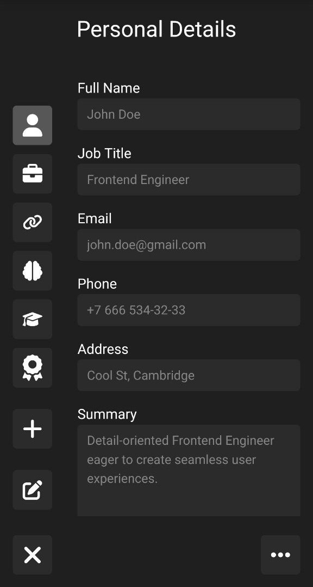
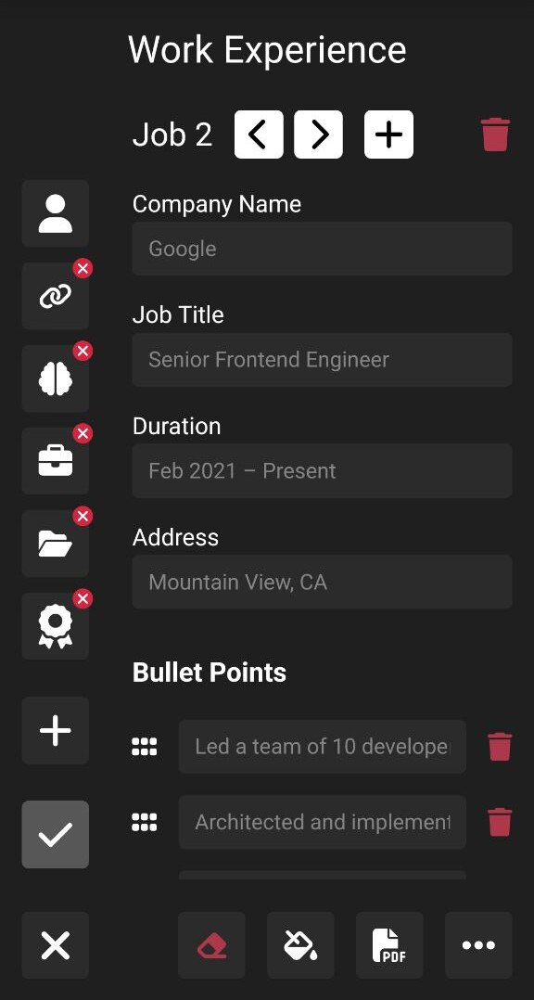
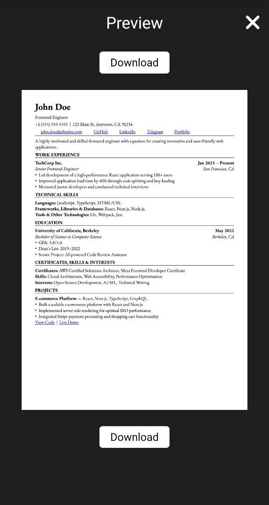

# Resume Constructor

Automatically generate a standard software engineering CV from your content.

**[Open Live Demo](https://resume-constructor.sholokhov.dev)**


---

## Mobile Experience

> [!IMPORTANT]
> Tablet and desktop live-preview work is proposed, including the possible layouts described in the roadmap. The screenshots below show the mobile interface.

|                                         **1. Clean Editor**                                          |                                      **2. Intuitive UI**                                      |                                       **3. Professional Output**                                       |
| :--------------------------------------------------------------------------------------------------: | :-------------------------------------------------------------------------------------------: | :----------------------------------------------------------------------------------------------------: |
|  |  |  |

---

### Key Engineering Highlights

- **Architecture:** Reusable UI, feature composition and business logic are separated, with meaningful extracted logic and its tests colocated. See the [TypeScript and React reference](docs/reference/typescript-react.md).
- **Build System:** Vite and Vitest configuration lives in [`vite.config.ts`](vite.config.ts) and [`vitest.config.ts`](vitest.config.ts).
- **Type Safety:** Deep immutability is the default through `ReadonlyDeep`. `ReadonlyExcept` is available for legitimate mutable exceptions such as refs; it is not required for every component.
- **Testing Strategy:** Pure logic runs in Node, component and hook contracts run in a simulated DOM, and browser-dependent interactions such as native dialogs, focus geometry and drag-and-drop run in Chromium. Playwright also provides E2E and visual tests. See the [testing reference](docs/reference/testing.md) and [`vitest.config.ts`](vitest.config.ts).
- **Inclusive Design:** Create and organise your CV with keyboard controls, clear labels and managed focus. The web editor and preview target WCAG 2.2 AA; see the [accessibility reference](docs/reference/accessibility.md) for current support and limitations.
- **Document Rendering Pipeline:** `@react-pdf/renderer` generates a PDF Blob for download and preview. Inside a native `<dialog>` modal, `pdfjs-dist` renders PDF pages to canvas with an aligned text layer for selection and copying. Matching the preview to the exported PDF is a product requirement, not a guarantee of pixel equality; see the [product reference](docs/reference/product.md).
- **Export Goals:** Accessible exported CVs and verified Applicant Tracking System (ATS) compatibility remain future goals, not established capabilities. Selectable text and links alone do not establish document accessibility.

---

### Project Structure & Organisation

The codebase uses component colocation where useful. Extracted pure logic and its tests live together; barrel exports are not mandatory.

```text
src/
├── components/                # Shared UI Kit (buttons, popups, toolbar)
│   └── AddSections/           # Colocation: Logic, styles, tests and types
│       ├── AddSections.tsx
│       ├── AddSections.scss   # BEM styling
│       ├── AddSections.test.tsx
│       ├── AddSections.browser.test.tsx
│       ├── getAddableSectionIds.ts
│       ├── getAddableSectionIds.test.ts
│       └── index.tsx          # Barrel export
├── pages/                     # Feature views (Education, Experience, Skills)
├── hooks/                     # Reusable stateful logic
│   ├── useResumeData/         # Complex state management logic
│   └── useResumeData.test.ts  # Hook testing
├── styles/                    # SCSS architecture (7-1 pattern adaptation)
│   ├── base/                  # Typography, resets
│   ├── utils/                 # Variables, mixins, functions
│   └── blocks/                # BEM blocks used by many different components
└── types/                     # Shared TypeScript interfaces
```

### Tech Stack & Methodology

- **Core:** React 19, TypeScript.
- **Styling:** SCSS + BEM.
  - _Why?_ Chosen over utility-first frameworks (Tailwind) to maintain strict control over the cascade, isolate component styles and ensure precise print layouts.
- **State Management:** Custom hooks.
- **Quality Control:** ESLint, Stylelint, Prettier, Husky and lint-staged support the workflow; executable settings and commands live in the [configuration](package.json). See the [verification reference](docs/reference/verification.md) for the distinction between checks and review.
  - The ESLint setup originally used Airbnb's JavaScript Style Guide before moving to a custom flat configuration for TypeScript.

### Documentation & Roadmap

Comprehensive technical documentation, architecture deep dives and the complete TypeDoc API reference are available on our documentation portal:

- **Documentation Portal:** [docs.resume-constructor.sholokhov.dev](https://docs.resume-constructor.sholokhov.dev)
- **Detailed Roadmap & Technical Decisions:** [docs.resume-constructor.sholokhov.dev/guides/roadmap](https://docs.resume-constructor.sholokhov.dev/guides/roadmap)

#### Proposed Roadmap

The backlog includes responsive multi-screen editing and a possible DOM live preview, draft recovery, form ergonomics and internationalisation. Layout, breakpoints and preview architecture are proposals requiring design approval rather than approved implementations. See the [roadmap](https://docs.resume-constructor.sholokhov.dev/guides/roadmap) for details.

### Setup & Development

_Bun (v1.2+) is required. The repository uses `bun.lock` and relies on Bun runtime scripts for local development, testing and building._

```Bash
# Clone the repository
git clone https://github.com/fiftythanks/resume-constructor.git

# Install dependencies
bun install

# Run development server
bun start

# Run interactive Vitest tests
bun run test

# Run E2E tests
bun run e2e
```

### Contributing

Please review [CONTRIBUTING.md](CONTRIBUTING.md) for details on our code style,
branching model, git hooks and Conventional Commits specification.
