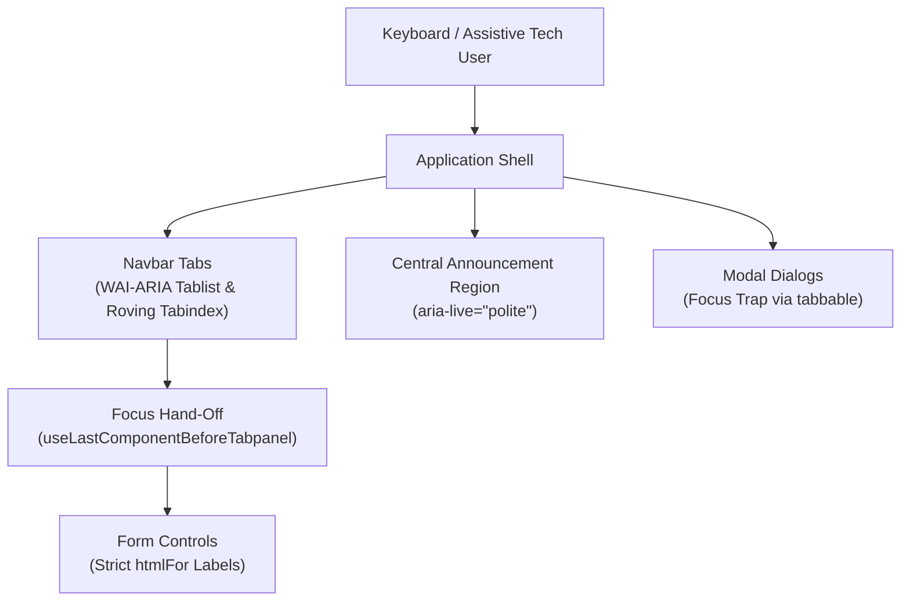

WCAG 2.2 Level AA is the target for the editor and preview interaction, not a claim of verified conformance. The patterns below describe existing mechanisms, not proof that every interaction has been audited. See the [accessibility reference](https://github.com/fiftythanks/resume-constructor/blob/main/docs/reference/accessibility.md) and [testing reference](https://github.com/fiftythanks/resume-constructor/blob/main/docs/reference/testing.md).

---

## 1. Keyboard Navigation & Tab Management

The primary section navigation implements the **W3C WAI-ARIA Tabs Pattern**:

- **Semantic Role Hierarchy:** The navigation container uses `<ul role="tablist" aria-orientation="vertical">`. Each individual section button implements `role="tab"`, `aria-selected={isSelected}` and `aria-controls="<sectionId>-tabpanel"`.
- **Roving Tabindex:** Only the currently active section tab receives `tabIndex={0}`. All other tabs are set to `tabIndex={-1}`.
- **Directional Traversal:**
  - `ArrowDown` and `ArrowUp` move focus sequentially between active section tabs.
  - Boundary wrapping automatically moves focus to "Add Sections" or "Edit Sections" buttons at the ends of the tab list.
  - `Delete` key on an active tab deletes the section and transfers focus to the subsequent or preceding tab button.
  - `Escape` exits editor mode and restores focus to the corresponding section tab.

---

## 2. Modal Dialog Focus Trapping (`Popup`)

The modal primitive in `src/components/Popup/` uses patterns from the **W3C APG Modal Dialog Pattern**:

- **Native Dialog Semantics:** Built using the native HTML `<dialog>` element rendered via React portals into `#popup-root`.
- **Attributes:** Configured with `aria-modal="true"` and `aria-labelledby="<id>-title"`.
- **Focus Containment via `tabbable`:** When opened, focus is immediately shifted to the first interactive element. Pressing `Tab` or `Shift+Tab` cycles strictly within the modal boundaries.
- **Browser-Sensitive Behaviour:** Native dialog mechanics and focus geometry need browser evidence. Other tests use Node or a simulated DOM as appropriate; not all unit and integration tests run in Chromium.
- **Dismissal & Focus Restoration:** Pressing `Escape` or clicking the close button dismisses the dialog and returns keyboard focus to the originating trigger element.

---

## 3. Reverse Focus Boundary Navigation

When a keyboard user tabs from the navbar into an open tabpanel, focus lands on the first form control. However, when navigating backwards using `Shift+Tab`, standard DOM order would jump into preceding layout containers rather than returning to the active tab.

`src/hooks/useLastComponentBeforeTabpanel.ts` solves this boundary dilemma:

1. Tracks focus entry into tabpanels using `focusin` events and verifies whether `e.relatedTarget` was the activating section tab.
2. Intercepts `Shift+Tab` on the first interactive element via `e.preventDefault()`.
3. Programmatically transfers focus back to the controlling tab button, creating complete bidirectional focus symmetry.

---

## 4. Screen Reader Live Announcements

The application uses an `aria-live="polite"` region in `src/App/App.tsx` for dynamic UI updates such as section activations, deletions and reordering. Polite announcements wait for the current screen reader utterance; other interactions may require a different urgency.

- **Live Region:** The existing polite region communicates contextual changes.
- **Dynamic Diffing:** `useAppState` calculates set symmetric differences between previous and current section states, dispatching contextual announcements such as:
  - `"Section Work Experience was added."`
  - `"Section Personal Details was opened."`
  - `"Editor Mode on. To move focus to tabs for editing, press Tab."`
- **Drag-and-Drop Feedback:** Detailed feedback announces when sortable items are picked up, moved over target positions, dropped or cancelled.

Initial drag feedback should not misleadingly suggest that an item has moved over itself; the implementation context is `src/components/BulletPoints/bulletPointsDnd.ts`.

## 5. Exported CV Accessibility

Accessible exported CVs are a future goal distinct from web accessibility. Semantic structure and meaningful reading order are needed; selectable text, metadata and working links alone do not establish them.

On 14 November 2026, a synthetic probe using `@react-pdf/renderer` 4.9.0 and `pdfjs-dist` 6.4.299 extracted text and a link but found no PDF structure tree or heading/list roles. This is evidence of a current semantic export gap in that representative output, not a test of an actual CV template or proof that accessible PDF generation is impossible. The [accessibility reference](https://github.com/fiftythanks/resume-constructor/blob/main/docs/reference/accessibility.md) records the scope and limitations.
