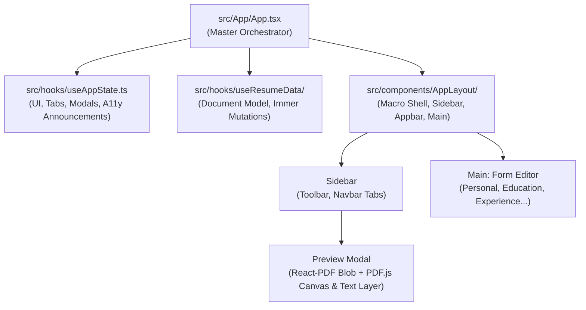

Resume Constructor uses React, TypeScript, SCSS, Vite, Vitest and Bun. Its architecture separates presentation, form state, document rendering and accessibility infrastructure. The [product reference](https://github.com/fiftythanks/resume-constructor/blob/main/docs/reference/product.md) describes the CV structure and guidance sources.



---

## Architectural Principles

### 1. UI Composition

The application uses its own UI components, semantic HTML, SCSS and accessibility patterns. Reusable interface components, feature composition and business logic have distinct roles; see the [TypeScript and React reference](https://github.com/fiftythanks/resume-constructor/blob/main/docs/reference/typescript-react.md).

### 2. Component Colocation

A component directory can group its implementation, styles and tests, for example:

```text
src/components/Button/
├── Button.tsx         # Component implementation and prop types
├── Button.scss        # Scoped BEM styles
├── Button.test.tsx    # Vitest + vitest-browser-react suite
└── index.tsx          # Barrel, where useful
```

This example is descriptive, not a mandatory four-file template. Meaningful extracted pure logic and its tests belong together; private helpers do not need barrel exports. Native documentation discovery does not require manual registration.

### 3. Deep Immutability

`ReadonlyDeep` is the default for immutable props and other inputs. `ReadonlyExcept` is useful when a legitimate exception, such as a mutable ref, needs to remain mutable. It is not required for every component. See the [TypeScript and React reference](https://github.com/fiftythanks/resume-constructor/blob/main/docs/reference/typescript-react.md).

---

## State Management Architecture

State is decoupled into two primary custom hooks coordinated by `App.tsx`:

### 1. Document Data Model (`useResumeData`)

Manages the structured content of the resume (`Personal`, `Education`, `Experience`, `Projects`, `Skills`, `Certifications`, `Links`).

- Uses `use-immer` for nested draft updates. Immer is useful for complicated updates, not mandatory for every nested change.
- Provides atomic action creators (`updateName`, `addDegree`, `deleteJob`, `reorderSkills`) ensuring consumer components never manipulate state shape directly.
- Encapsulates bulk operations (`clearAll`, `fillAll`, `clearSection`).

### 2. UI & Interaction State (`useAppState`)

Manages ephemeral shell state and section orchestration:

- **Active Section IDs:** The ordered collection of enabled resume sections (`activeSectionIds`).
- **Opened Section ID:** The currently opened section tab displayed in the form editor (`openedSectionId`).
- **Editor Mode:** Section management mode in the navbar (`editorMode`) enabling drag-and-drop section reordering and one-click section removal.
- **Screen Reader Live Announcements:** Centralised string (`screenReaderAnnouncement`) announcing section additions, deletions and reordering via `aria-live="polite"`.
- **Section Operations:** Callbacks to add, delete, open and reorder sections.

Modal dialog visibility is managed locally within each respective shell component rather than in `useAppState`:

- `Navbar` manages the `<AddSections>` popup dialog (`isAddSectionsPopupShown`).
- `Toolbar` manages the full-screen `<Preview>` modal dialog (`isPreviewModalShown`).
- Toolbar operations such as "Clear All" (`deleteAll`) and "Fill All" (`fillAll`) trigger state resets immediately without modal popups.

### Derived State and Effects

Values derivable from current state can be computed during rendering or in the interaction that changes them, avoiding redundant synchronisation. Effects remain appropriate when synchronising with an external system, such as the PDF rendering pipeline.

---

## Directory Organisation

```text
resume-constructor/
├── docs/                     # Astro Starlight documentation portal
├── src/
│   ├── App/                  # Application shell and font initialisation
│   ├── assets/               # Static icons and graphic assets
│   ├── components/           # Reusable, domain-agnostic UI primitives
│   │   ├── AddSections/      # Section selection modal dialog
│   │   ├── AppbarIconButton/ # Responsive appbar action buttons
│   │   ├── AppLayout/        # Macro shell (Sidebar, Navbar, Toolbar, Main)
│   │   ├── BulletPoints/     # Dynamic sortable accomplishment lists
│   │   ├── Button/           # Base button primitive
│   │   ├── Popup/            # Modal dialog wrapper with focus trap
│   │   └── Preview/          # PDF rendering, canvas rasterisation and text layer overlay
│   ├── hooks/                # Custom React hooks (state, layout, a11y)
│   ├── pages/                # Feature form sections (Personal, Education...)
│   ├── styles/               # Global SCSS, custom properties, BEM base
│   ├── types/                # TypeScript domain interfaces and utility types
│   └── utils/                # Pure helper functions (capitalize, neverReached)
├── index.html                # Application HTML entry point
├── vite.config.ts            # Vite 8 build and dev server configuration
└── vitest.config.ts          # Vitest project and environment configuration
```
