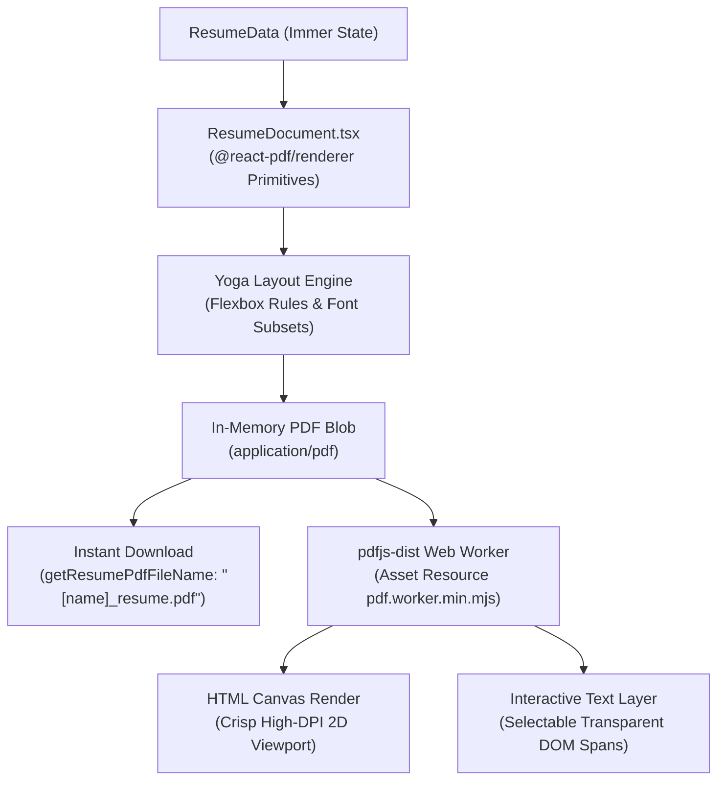

A central technical challenge in client-side resume generation is achieving exact visual parity between what the user sees in the browser and what is exported to the final PDF file. Standard browser printing (`window.print()`) suffers from variable browser margins, font rendering discrepancies and page break clipping.

Resume Constructor solves this problem through a dual-engine rendering pipeline:

1. **Compilation Engine:** `@react-pdf/renderer` declaratively constructs an A4 document according to strict Yoga Flexbox layout rules and generates an in-memory binary PDF `Blob`.
2. **Pre-Download Inspection Engine:** Mozilla's `pdfjs-dist` consumes the generated PDF buffer, rasterises the exact document pages onto an HTML `<canvas>` element and mounts an interactive transparent text layer overlay inside an on-demand modal preview before downloading.

---

## 1. Declarative Document Construction

The exported document is defined in `src/components/Preview/ResumeDocument.tsx` and `ResumeSection.tsx` using `@react-pdf/renderer` primitive components (`Document`, `Page`, `View`, `Text`, `Link`, `Svg`, `Path`):

- **Physical Page Formatting:** The root `<Page size="A4">` enforces standard international A4 dimensions (595.28pt by 841.89pt, an aspect ratio of approximately 0.707).
- **Page Break Control:** Multi-line items (such as individual job entries or degree cards) are configured with `wrap={false}`. This directs the Yoga layout engine to prevent breaking an accomplishment block awkwardly across page boundaries.
- **Content-Based Delimiter Rendering:** Header contact delimiters (bullet points separating email and custom links) are rendered conditionally based on whether valid items exist, preventing orphaned delimiters when contact entries are omitted.
- **Sanitised Filename Generation:** When triggering a download, `getResumePdfFileName` sanitises the applicant's name from Personal details, stripping filesystem-reserved characters (`<>:"/\|?*` and ASCII control codes) and substituting whitespace with underscores to format filenames such as `"john_doe_resume.pdf"` or defaulting to `"resume.pdf"`.
- **Font Subsetting & Preloading:** TTF font binaries are registered via `Font.register` to avoid runtime decompression latency. Before document compilation begins, `Preview.tsx` preloads `EBGaramond` variants (`normal`, `normalBold` and `italic`) using `Font.load` in an asynchronous effect. Document compilation is gated by `areFontsLoaded` to eliminate unstyled fallback glyphs during initial rendering.

---

## 2. Yoga Layout Engine Constraints

Unlike standard web CSS, layout in `@react-pdf/renderer` is driven entirely by the Yoga layout engine. This imposes strict architectural constraints:

- **No CSS Grid or Floats:** All layout arrangements must be composed strictly using Flexbox (`flexDirection: 'row'`, `justifyContent: 'space-between'`, `alignItems: 'baseline'`).
- **No CSS Variables or Dynamic Functions:** CSS custom properties, `clamp()`, `calc()` and `first baseline` are unsupported in Yoga. All measurements must be resolved to static point (`pt`) or pixel values.
- **SVG Path Rendering:** Brand icons (GitHub, LinkedIn, Website, Telegram) are rendered using vector `<Svg viewBox="0 0 640 640">` with explicit `<Path>` definitions rather than external image files or CSS font glyphs.

---

## 3. On-Demand Modal Canvas & Interactive Text Layer

The pre-download inspection modal in `src/components/Preview/Preview.tsx` visualises the real document compiled from `@react-pdf/renderer` without relying on inconsistent native browser PDF reader plug-ins:

:::note
This canvas rendering is strictly executed on demand when opening the preview modal before downloading. It is intentionally not dynamic during interactive typing: compiling `@react-pdf/renderer` documents into binary blobs and rasterising pages onto a `<canvas>` dynamically on every keystroke would be disastrous for performance. For real-time typing feedback, a lightweight pure-JSX DOM live preview is planned exclusively for larger displays where screen space allows (see [Roadmap](/guides/roadmap)).
:::

1. **Worker Offloading:** PDF parsing and font decoding run off the main thread inside `pdfjs-dist/build/pdf.worker.min.mjs`, loaded via webpack 5 as a standalone static asset (`asset/resource`) and assigned to `pdfjsLib.GlobalWorkerOptions.workerSrc`.
2. **High-DPI Canvas Rasterisation:** The preview calculates available container dimensions from the modal dialog and applies a high-DPI scaling factor (`scale: 2.0`) so vector shapes and typography remain sharp on Retina displays.
3. **Interactive Text Layer Overlay:** Positioned directly over the `<canvas>`, an invisible DOM text layer overlay (`pdfjsLib.TextLayer`) is populated via `page.getTextContent()`. It renders selectable, searchable DOM spans matching the underlying vector glyphs. The `--scale-factor` CSS variable is synchronised to match `viewport.scale`, enabling native text selection and clipboard copying while preserving high-resolution canvas visuals.
4. **Compiler Synchronisation & Cancellation:** `@react-pdf/renderer`'s `usePDF` hook is synchronised with document updates inside `useEffect`. In-flight render operations are tracked and cancelled via `renderTask.cancel()` and cancellation tokens whenever page indices change or new document blobs compile.
5. **DOM Attachment Guards:** All asynchronous rendering tasks verify `node.isConnected` on both `canvasNode` and `textLayerNode` before applying mutations or initiating render passes, safeguarding against race conditions when dialogs close mid-render.
6. **Window Resize Debouncing:** `useDebouncedWindowSize` debounces viewport adjustments by 1000ms (`DEBOUNCE_DELAY_MS = 1000`) before recalculating canvas dimensions.

---

## 4. Headless Testing Parity (JSDOM)

Standard JSDOM environments do not implement the HTML Canvas 2D rendering context (`HTMLCanvasElement.prototype.getContext('2d')` returns `null`).

To maintain test execution speed without native binary canvas dependencies:

- In `jest.setup.tsx`, `pdfjs-dist` is comprehensively mocked with `getDocument`, `getPage`, `getViewport`, `getTextContent`, `render` returning a cancellable promise and `TextLayer` mock supporting `render` and `cancel`.
- `Blob.prototype.arrayBuffer` is polyfilled to guarantee seamless binary buffer generation under Node.js and JSDOM.
- Native `HTMLDialogElement` methods (`showModal` and `close`) are mocked to manage the dialog's `open` state.
- The mocked `@react-pdf/renderer` provides pure DOM elements and a mocked `usePDF` tuple, allowing tests to execute in milliseconds while thoroughly verifying component lifecycle, focus traps and prop propagation.
