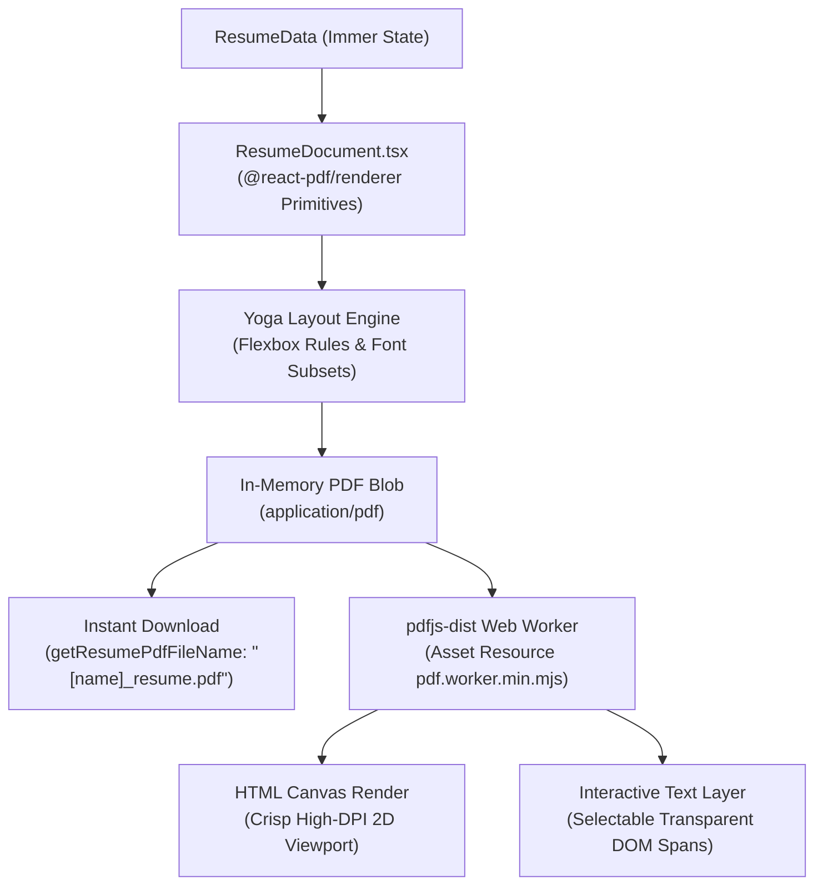

The standard preview is intended to match the exported PDF's content, typography, geometry, wrapping and pagination. Viewer and display edge smoothing can differ; using the same document does not by itself prove parity.

The modal preview uses a dual-engine rendering pipeline:

1. `@react-pdf/renderer` constructs the document and generates an in-memory PDF `Blob`.
2. `pdfjs-dist` reads the generated PDF, rasterises its pages onto an HTML `<canvas>` and mounts a selectable text layer in the modal.

See the [product reference](https://github.com/fiftythanks/resume-constructor/blob/main/docs/reference/product.md) for the parity requirement and the [accessibility reference](https://github.com/fiftythanks/resume-constructor/blob/main/docs/reference/accessibility.md) for export limitations.

---

## 1. Declarative Document Construction

The exported document is defined in `src/components/Preview/ResumeDocument.tsx` and `ResumeSection.tsx` using `@react-pdf/renderer` primitive components (`Document`, `Page`, `View`, `Text`, `Link`, `Svg`, `Path`):

- **Physical Page Formatting:** The root `<Page size="A4">` enforces standard international A4 dimensions (595.28pt by 841.89pt, an aspect ratio of approximately 0.707).
- **Page Break Control:** Multi-line items (such as individual job entries or degree cards) are configured with `wrap={false}`. This directs the Yoga layout engine to prevent breaking an accomplishment block awkwardly across page boundaries.
- **Content-Based Delimiter Rendering:** Header contact delimiters (bullet points separating email and custom links) are rendered conditionally based on whether valid items exist, preventing orphaned delimiters when contact entries are omitted.
- **Sanitised Filename Generation:** When triggering a download, `getResumePdfFileName` sanitises the applicant's name from Personal details, stripping filesystem-reserved characters (`<>:"/\|?*` and ASCII control codes) and substituting whitespace with underscores to format filenames such as `"john_doe_resume.pdf"` or defaulting to `"resume.pdf"`.
- **Font Registration & Preloading:** TTF font binaries are registered via `Font.register`. Before document compilation begins, `Preview.tsx` preloads `EBGaramond` variants (`normal`, `normalBold` and `italic`) using `Font.load` in an asynchronous effect. Document compilation is gated by `areFontsLoaded`.

---

## 2. Renderer and Browser Layout

React-PDF's document primitives and styling are distinct from browser DOM and CSS. Layout choices in one environment should not be assumed to behave identically in the other. Consult the current [React-PDF styling documentation](https://react-pdf.org/docs/v4/styling) and [floats documentation](https://react-pdf.org/docs/v4/floats) for supported capabilities. The document also uses vector SVG paths for icons.

---

## 3. On-Demand Modal Canvas & Interactive Text Layer

The pre-download inspection modal in `src/components/Preview/Preview.tsx` visualises the real document compiled from `@react-pdf/renderer` without relying on inconsistent native browser PDF reader plug-ins:

:::note
The canvas preview is opened on demand before downloading, rather than updating during typing. A DOM-based live preview for wider screens is a proposal requiring design approval, not an implemented feature; see the [roadmap](/guides/roadmap/). Its parity and performance would need evidence.
:::

1. **Worker Offloading:** PDF parsing and font decoding run off the main thread inside `pdfjs-dist/build/pdf.worker.min.mjs`, imported via Vite's `?url` static asset query (`pdfjs-dist/build/pdf.worker.min.mjs?url`) and assigned to `pdfjsLib.GlobalWorkerOptions.workerSrc`.
2. **High-DPI Canvas Rasterisation:** The preview calculates available container dimensions from the modal dialog and applies a high-DPI scaling factor (`scale: 2.0`) so vector shapes and typography remain sharp on Retina displays.
3. **Interactive Text Layer Overlay:** Positioned directly over the `<canvas>`, an invisible DOM text layer overlay (`pdfjsLib.TextLayer`) is populated via `page.getTextContent()`. It renders selectable, searchable DOM spans matching the underlying vector glyphs. The `--scale-factor` CSS variable is synchronised to match `viewport.scale`, enabling native text selection and clipboard copying while preserving high-resolution canvas visuals.
4. **Compiler Synchronisation & Cancellation:** `@react-pdf/renderer`'s `usePDF` hook is synchronised with document updates inside `useEffect`. In-flight render operations are tracked and cancelled via `renderTask.cancel()` and cancellation tokens whenever page indices change or new document blobs compile.
5. **DOM Attachment Guards:** All asynchronous rendering tasks verify `node.isConnected` on both `canvasNode` and `textLayerNode` before applying mutations or initiating render passes, safeguarding against race conditions when dialogs close mid-render.
6. **Window Resize Debouncing:** `useDebouncedWindowSize` debounces viewport adjustments by 1000ms (`DEBOUNCE_DELAY_MS = 1000`) before recalculating canvas dimensions.

---

## 4. Testing the Pipeline

Tests use Node, a simulated DOM or a browser according to the contract being checked. Browser execution is appropriate for native dialog and canvas-related behaviour; see the [testing reference](https://github.com/fiftythanks/resume-constructor/blob/main/docs/reference/testing.md).

Component suites use mocks for PDF.js and `@react-pdf/renderer` to exercise interaction and rendering lifecycle contracts deterministically. These mocks do not generate a real PDF or establish its content, semantic structure or visual parity. Actual PDF generation and browser inspection need separate evidence; the separate Playwright E2E/visual block is currently disabled in CI.
